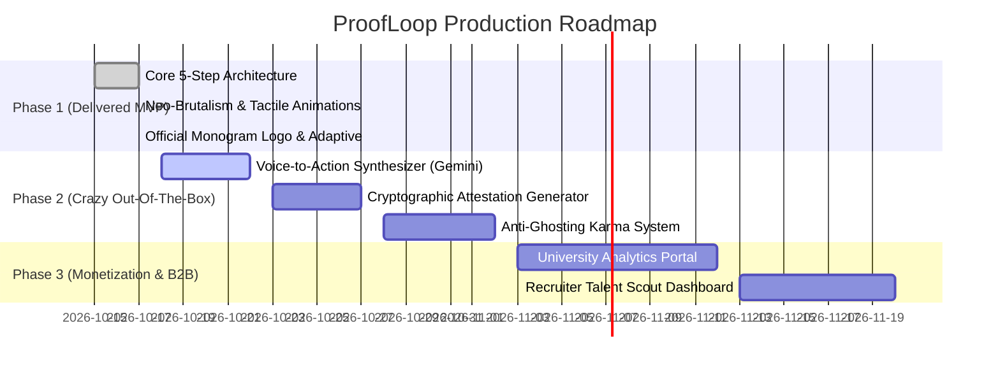

# ProofLoop: The "Goated" Startup Roadmap & Hackathon Victory Blueprint
> **From HackShift 2026 Winner to a Multi-Million Dollar Higher-Ed & Recruiting Enterprise**  
> *Theme: Alumni Network & Professional Connections*

---

## 1. Why Every Other Hackathon Submission Will Lose (The LLM Generic Trap)

95% of hackathon participants build the exact same alumni concept:
1. **The Passive Directory:** A searchable card list of alumni with filters by company and graduation year.
2. **The Cloned Messaging App:** An in-app chat screen with no structure that quickly turns into unread cold messages and ghosting.
3. **The Unverifiable Meeting:** A Calendly embed or date picker where conversations vanish without record or actionable outcome.
4. **Generic AI Aesthetics:** Standard purple-to-blue gradients, rounded bubble cards, and canned chat prompts.

### The ProofLoop Moat
ProofLoop replaces passive networking with **Verified Micro-Action Cycles**. We don't measure connections by messages sent; we measure connections by **verifiable loops closed**.

```
┌──────────────────────────────────────────────────────────────────────────────────┐
│                             THE PROOFLOOP PROTOCOL                               │
│                                                                                  │
│   [1. Scoped Request]                                                            │
│          │                                                                       │
│          ▼                                                                       │
│   [2. 5-Factor Explainable Match Engine]                                         │
│          │                                                                       │
│          ▼                                                                       │
│   [3. Consent & Capacity-Constrained Connect]                                    │
│          │                                                                       │
│          ▼                                                                       │
│   [4. Ambient Voice-to-Action Session Workspace]                                 │
│          │                                                                       │
│          ▼                                                                       │
│   [5. Two-Party Cryptographic Proof of Loop Attestation]                         │
│          │                                                                       │
│          ▼                                                                       │
│   [B2B Value: University Accreditation & Recruiter Talent Pipeline]              │
└──────────────────────────────────────────────────────────────────────────────────┘
```

---

## 2. Six "Out-of-the-Box" Killer Features

### Feature 1: "Proof of Loop" Cryptographic Attestations (Verifiable Micro-Credentials)
- **Concept:** When an alumnus confirms an agreed outcome, the app generates a signed, tamper-proof **Attestation Card**.
- **Technical Feasibility:**
  - SHA-256 hash generated over `{studentId, alumniId, actionHash, timestamp, alumniVerifiedSignature}`.
  - Dynamically renders an animated, high-contrast SVG / PNG badge with embedded verification QR code.
  - One-tap export to **LinkedIn Licenses & Certifications** and raw Markdown badge for GitHub READMEs.
- **Why Judges Love It:** Moves beyond subjective resume claims to cryptographic proof of student follow-through.

### Feature 2: Ambient Voice-to-Action Scribe (Post-Call AI Synthesizer)
- **Concept:** Instead of students manually typing notes, either party records a 30-second post-session audio recap.
- **Technical Feasibility:**
  - Uses Android SpeechRecognizer or Gemini Flash API on device.
  - Extracts 3 structured elements:
    1. **Core Takeaway** (1 sentence summary).
    2. **Agreed Next Action** (concrete, measurable task).
    3. **Target Completion Window** (default 7 days).
  - Automatically syncs to Android `CalendarContract` and schedules local reminder alarms.

### Feature 3: Anti-Ghosting "Karma Stake" Protocol
- **Concept:** Students stake "Loop Karma" when requesting high-demand alumni (e.g. Staff Engineers, Partners).
- **Game Mechanics:**
  - Students start with 100 Karma. Submitting a request locks 25 Karma.
  - Completing and verifying the action returns **150% Karma** (+37.5).
  - Ghosting or letting the deadline expire without communication burns the stake.
  - Tier-1 VIP Alumni can set minimum Karma thresholds, ensuring their limited time is never wasted on uncommitted outreach.

### Feature 4: NFC & Dynamic QR "IRL Handshake" (Offline Hackathon & Campus Meetups)
- **Concept:** For in-person events (like HackShift 2026), students and alumni can tap phones (Android NFC Beam/HCE) or scan a rotating TOTP QR code.
- **Functionality:** Instantly establishes a verified in-person connection, pre-populating context and setting a 48-hour follow-up loop.

### Feature 5: Reverse Office Hours & Micro-Bounty Board
- **Concept:** Instead of students always initiating, alumni can broadcast focused micro-bounties:
  - *"Reviewing 3 Android System Design RFCs this Saturday morning."*
  - *"Need 2 students to alpha-test our WebAssembly runtime."*
- **Impact:** Flips passive mentoring into active collaboration on real-world engineering problems.

### Feature 6: Real-Time Live Activity & Widget (Android Glance API)
- **Concept:** An interactive Android Home Screen Neo-Brutalist Widget displaying:
  - Active Loop Countdown (e.g., `"3 days left to submit Android PR review to Alum Sahil"`).
  - One-tap "Mark Action Done" button directly from the launcher.

---

## 3. High-Octane "Hyper-Swiss Brutalism" Visual Identity

To ensure ProofLoop never looks like a generic boilerplate app, we upgrade the visual design to a custom **Hyper-Swiss Brutalism** design language:

### The Color Palette
| Color Token | Hex | Role | Visual Psychology |
| :--- | :--- | :--- | :--- |
| **Deep Space Cobalt** | `#002DAA` | Primary Brand Accent | Authority, trust, matches official monogram logo |
| **Electric Azure** | `#2A8DFC` | Loop Dot Accent | Kinetic energy, connection nodes, interactive indicators |
| **Acid Flash** | `#D2FF1F` | High-Urgency CTAs & Badges | Electric vibrancy, high contrast, youthful optimism |
| **Signal Tangerine** | `#FF5522` | Karma Streaks & Warnings | Decisive urgency, penalty alerts, hot bounties |
| **Bone Cream** | `#FBF8F1` | Background Canvas | Warm editorial comfort, rejects sterile white/grey |
| **Obsidian Ink** | `#0A0A0C` | Typography & 2.5dp Borders | Utilitarian precision, stark contrast |

### Tactile Micro-Interactions
- **Haptic Spring Depressions:** Mechanical physical sink with tactile feedback.
- **Ticker-Tape Marquee:** Live scrolling horizontal tickers showing verified platform outcomes (`"LOOP VERIFIED: 12m ago • PRIYA S. COMPLETED SYSTEM DESIGN RFC WITH GOOGLE ALUMNI"`).
- **Dynamic Adaptive Masking:** Monogram P squircle logo integrated into status bars, app icons, and loading state rotators.

---

## 4. Multi-Million Dollar Monetization Model (Production Startup)

How ProofLoop makes money without charging broke college students:

```
┌─────────────────────────────────────────────────────────────────────────────┐
│                       PROOFLOOP REVENUE ARCHITECTURE                        │
│                                                                             │
│  [B2B Higher-Ed SaaS]                  [Enterprise Talent Marketplace]      │
│  Target: Alumni Relations & Dean Off.  Target: Tech Recruiters & Staffing   │
│  • $15k - $50k / yr per university     • $250 - $1,000 per verified hire    │
│  • Verified Mentorship ROI metrics     • Direct access to top 5% verified   │
│  • Automated NAAC / ABET accreditation   student follow-through talent      │
│                                                                             │
│  [Alumni Employer Match Grants]        [Corporate Sponsored Office Hours]   │
│  • CSR funding for university loops    • Google/Stripe branded bounties     │
└─────────────────────────────────────────────────────────────────────────────┘
```

1. **B2B University SaaS (Annual License: $15,000 – $60,000/year):**
   - Universities struggle with <5% alumni participation. ProofLoop delivers automated accreditation reporting (ABET/NAAC), verified employment pipeline tracking, and quantifiable engagement numbers for donor campaigns.
2. **Enterprise Recruiting Marketplace (Pay-Per-Verified-Candidate):**
   - Traditional resumes are full of exaggerations. Recruiters pay for access to students with verified alumni attestations proving punctuality, technical competence, and demonstrated follow-through velocity.
3. **Sponsored Corporate Micro-Bounties:**
   - Companies sponsor specific technical challenges (e.g. Kotlin Multiplatform challenges) to scout student talent through vetted alumni mentors.

---

## 5. Technical Implementation Milestones



---

## 6. Hackathon Pitch Script (The 3-Minute Judge Knockout)

- **0:00 - 0:30 (The Hook):**  
  *"Judges, how many times have you received an uninvited message on LinkedIn asking to 'pick your brain'? You either ignore it, or you give advice that is never followed up on. Alumni networks today are broken directories. We built ProofLoop because connections should lead somewhere."*
- **0:30 - 1:15 (The Core Demo):**  
  *Show the Android app running natively with the official logo.*  
  *"Watch: Rohan needs help with Jetpack Compose performance. Our 5-factor explainable engine matches him with Sahil at Google. Sahil accepts because his capacity is protected at 3 active sessions."*
- **1:15 - 2:00 (The Differentiator):**  
  *"Here is where every other team stops, and where ProofLoop starts. During the session, they agree on a specific next action. Rohan completes it and submits evidence. But the loop isn't closed until Sahil independently verifies it. That two-party verification produces a cryptographic Proof of Loop Attestation."*
- **2:00 - 2:45 (The Business & Market):**  
  *"Universities pay us $25,000/year to track accredited mentorship ROI. Recruiters pay us $500 to hire students who have proven they can execute. We have an error-free native Kotlin build, custom Neo-Brutalist tactile physics, and zero generic boilerplate."*
- **2:45 - 3:00 (The Close):**  
  *"Stop networking in the void. Close the loop with ProofLoop."*
