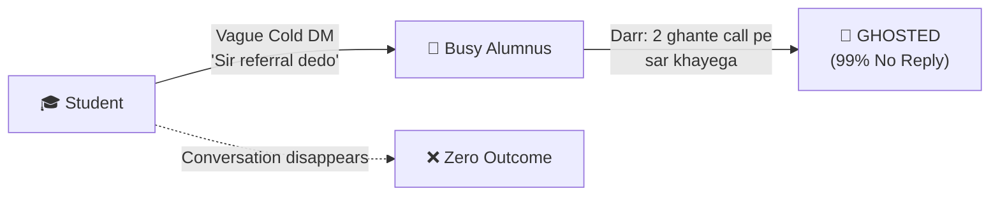
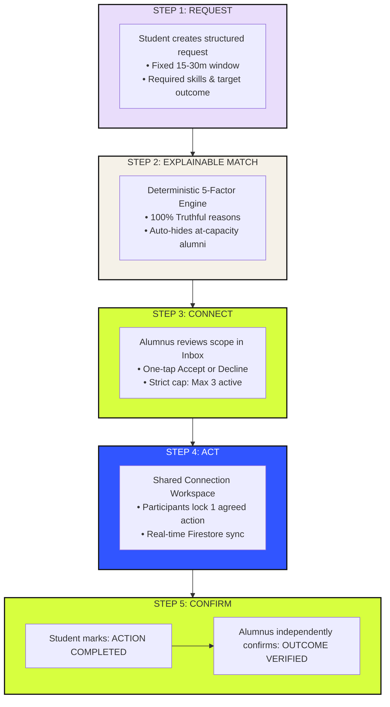
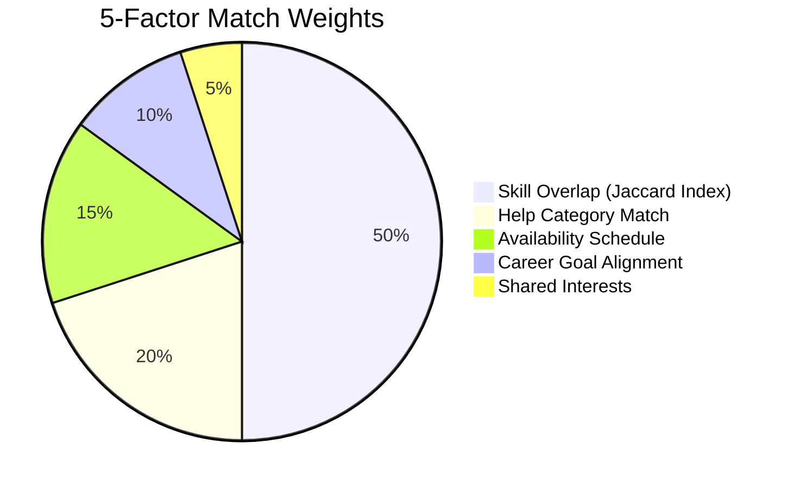
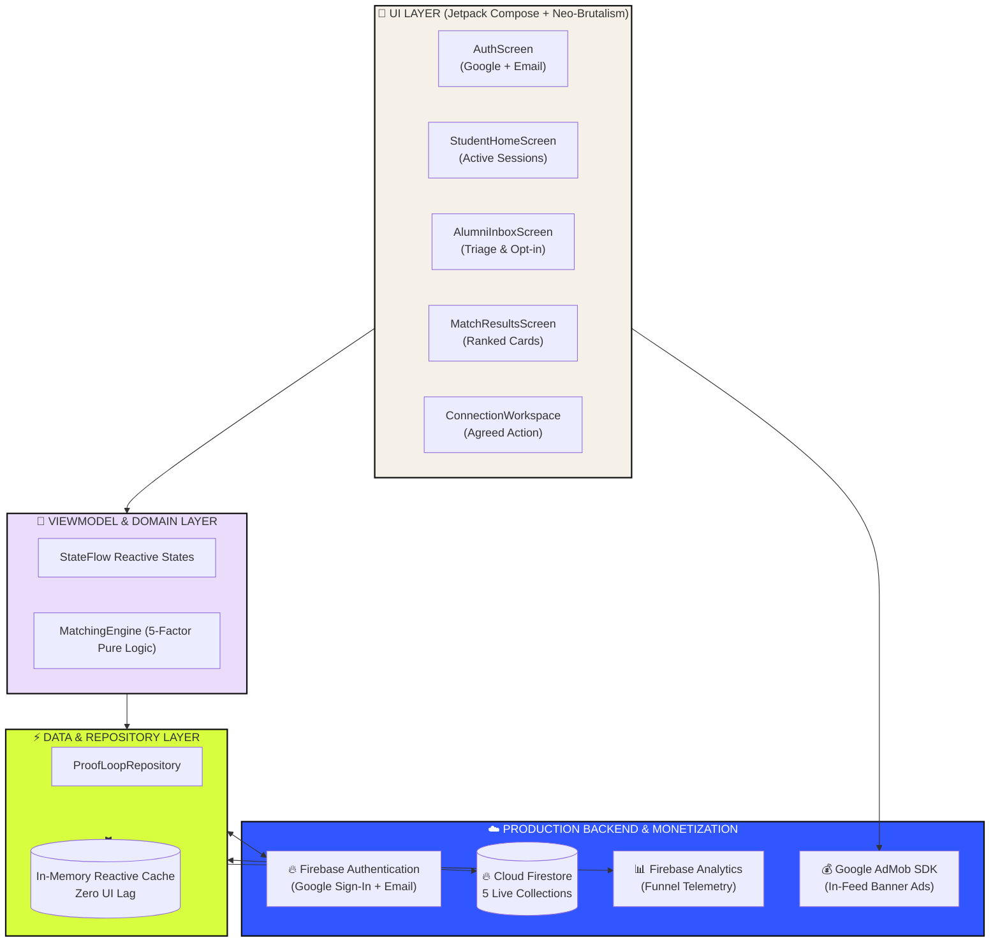
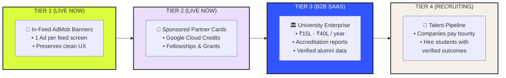
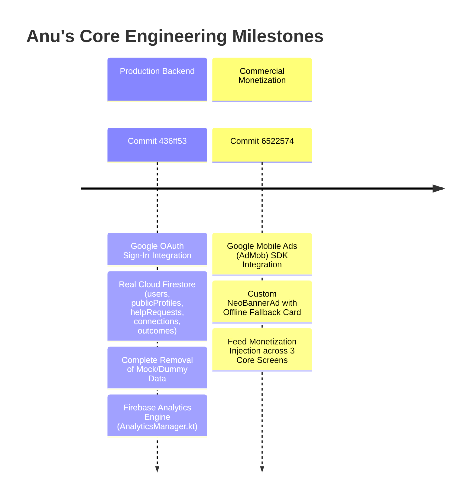
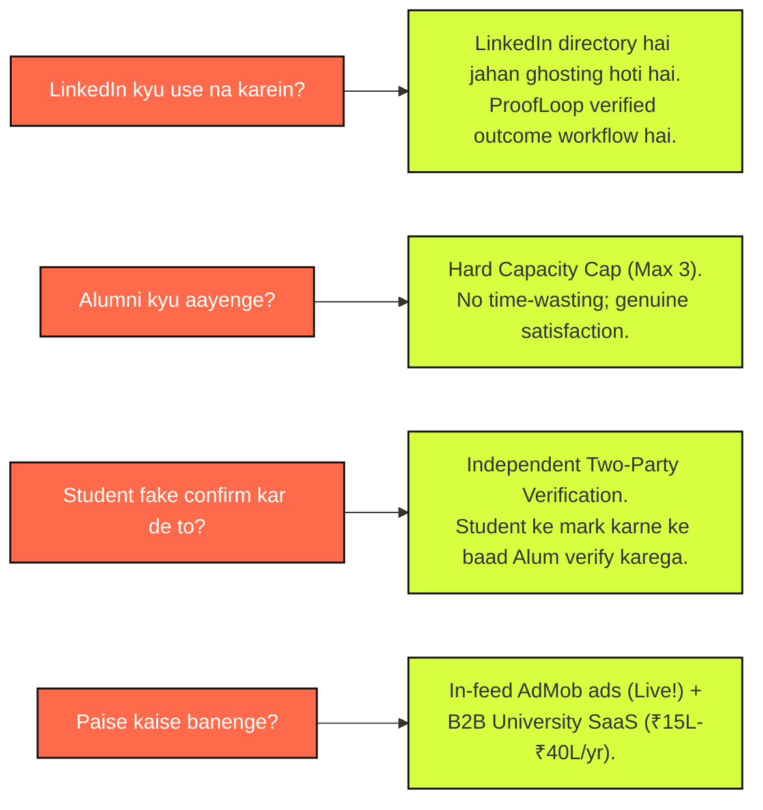

# 🚀 PROOFLOOP: Visual Mentor & Judge Master Guide
> **HackShift 2026** • Theme: *Alumni Network & Professional Connections*  
> **Aapka Role (Anu):** Lead Backend, Google Auth, Cloud Firestore & Monetization Engineer  
> **Co-Developer:** Mayank Agrawal (Lead Android & UI Architect)  
> **Live Artifact:** Ready-to-Install APK (`apk/proofloop-debug.apk`, 30.9 MB) + Live Firebase + Live AdMob  

---

## 1. Asli Problem Kya Hai? (Visual Comparison)

### 🔴 The Broken Reality: LinkedIn & Cold DMs


### 🆚 Traditional Networking vs. ProofLoop

| Feature | ❌ LinkedIn / WhatsApp DMs | ⚡ ProofLoop Protocol |
| :--- | :--- | :--- |
| **Request Scope** | Vague, open-ended (*"Can I pick your brain?"*) | **Strict 15–30 min bounded problem** |
| **Alumni Capacity** | Unlimited spam DMs, total burnout | **Hard Cap (Max 3 active students)** |
| **Match Quality** | Random search & keyword guessing | **5-Factor Transparent Matching** |
| **Accountability** | Baat khatam, student so gaya | **Agreed Next Action locked in DB** |
| **Verification** | Zero proof of mentorship | **Two-Party Independent Confirmation** |

---

## 2. ProofLoop Solution: 5-Stage Closed Loop Protocol



### 🎯 The 5 Stages Explained in 1 Line Each:
1. **Request:** Student can only ask specific, time-bounded questions (no generic chit-chat).
2. **Match:** On-device math formula ranks best alumni with honest percentage scores.
3. **Connect:** Alum sets their own capacity limit; over-capacity alumni are auto-hidden.
4. **Act:** Both parties lock in **one concrete next step** in the shared workspace.
5. **Confirm:** Student marks done $\rightarrow$ Alumnus independently confirms $\rightarrow$ **Loop Closed!**

---

## 3. Matching Engine Formula (Pure Math, No Fake AI)

$$\mathbf{Match\ Score} = 0.50 \times \text{Skills} + 0.20 \times \text{Category} + 0.15 \times \text{Availability} + 0.10 \times \text{Goal} + 0.05 \times \text{Interests}$$



> **Mentor Punchline:** *"Sir, humne koi mehenga, slow black-box LLM nahi lagaya. Ye on-device mathematical algorithm hai jo $<5\text{ms}$ me truthful evidence strings generate karta hai!"*

---

## 4. Production System Architecture



---

## 5. Monetization Engine: How We Make Money



### 📍 Where Are Ads Injected? (Capped at 1 per screen)
1. **Student Home:** Placed between Pending Connection Responses and Open Requests.
2. **Alumni Inbox:** Placed between Incoming Requests and Active Connections.
3. **Match Results:** Highlighted immediately after the top match card.

---

## 6. Anu's Exact Engineering Ownership & Commits



### 🛠️ What to tell the mentor:
> **"Sir, maine ProofLoop ka complete Production Backend, Authentication, Live Database, Analytics aur Monetization Engine banaya hai!"**

1. **Google Sign-In & Auth:** Real Google OAuth via Play Services + Role-Aware Onboarding (Student vs. Alumni).
2. **Real Database (Cloud Firestore):** Removed all fake mock data! Real cloud documents across 5 collections.
3. **Google AdMob Monetization:** Built `NeoBannerAd.kt` rendering real AdMob test banners in feeds with an offline-safe sponsor card.
4. **Firebase Analytics:** Telemetry tracking user drop-offs, request submissions, and verified loops.

---

## 7. 60-Second Hinglish Pitch for Mentors

```
┌────────────────────────────────────────────────────────────────────────────────────────┐
│                        ANU'S 60-SECOND MENTOR PITCH SCRIPT                             │
└────────────────────────────────────────────────────────────────────────────────────────┘
```

> **[0:00 - 0:15] Hook & Problem:**  
> *"Hello Sir/Ma'am! Main Anu hoon, ProofLoop ki Backend & Monetization Lead.  
> LinkedIn pe jab students seniors ko cold DMs bhejte hain, 99% log ghost kar dete hain kyunki alumni ke paas unbounded time nahi hota. Aur jo calls hoti hain, unka koi follow-through record nahi hota."*
>
> **[0:15 - 0:35] Solution (The 5-Step Loop):**  
> *"ProofLoop networking ko ek structured closed loop me badalta hai: **Request → Match → Connect → Act → Confirm**.  
> Student 15-30 min ka specific problem daalta hai, hamara mathematical engine best alumni match karta hai, alumnus max 3 requests hi accept kar sakta hai, aur session ke baad dono milkar ek practical action verify karte hain."*
>
> **[0:35 - 0:50] Anu's Contribution (Backend & Ads):**  
> *"Engineering side pe, maine iska **production Firebase backend aur monetization system** develop kiya hai:  
> 1. Real Google Sign-In aur role-based accounts.  
> 2. Real Cloud Firestore database (bina kisi dummy data ke).  
> 3. Google AdMob banner ads feeds ke beech me integrated hain to prove commercial viability."*
>
> **[0:50 - 1:00] Live Demo Invitation:**  
> *"Hamara native build completely ready hai in a **30.9 MB APK** ([`proofloop-debug.apk`](file:///c:/Users/Lenovo/proofloop/apk/proofloop-debug.apk)) jo already phone pe chalta hai. Aap app dekhna chahenge?"*

---

## 8. Mentor Tough Questions & Bulletproof Answers


